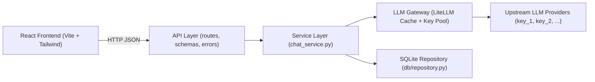

# LLM Chatbot with Key Failover and Response Caching

A decoupled full-stack AI chatbot featuring a **4-layer modular FastAPI backend** (LiteLLM key failover, response caching, failure simulation, and transactional SQLite persistence) and a **React + TypeScript + Tailwind CSS frontend**.

---

## Architecture



### API Contract

| Endpoint | Method | Success | Error Codes | Purpose |
|---|---|---|---|---|
| `/health` | `GET` | `200` | `503` | Verifies SQLite connectivity (`SELECT 1`), key pool, and cache readiness |
| `/chat` | `POST` | `200` | `422`, `503` | Runs multi-turn completion with failover & caching; persists turn atomically |
| `/sessions/{session_id}/messages` | `GET` | `200` | `404` | Returns oldest-first user & assistant messages (system prompt excluded) |

---

## 1. Live URLs

- **Frontend URL:** `http://localhost:3000` (replace with deployed Vercel / Netlify / Cloudflare Pages URL after deployment)
- **Backend URL:** https://llm-chatbot-with-key-failover-and.onrender.com
- **Health Endpoint:** https://llm-chatbot-with-key-failover-and.onrender.com/health
- **Repository:** https://github.com/JyotiKuma1/LLM-Chatbot-with-Key-Failover-and-Response-Caching

---

## 2. Run locally: with Docker and without

### With Docker

1. Copy the environment template and configure your API keys:
   ```bash
   cp .env.example .env
   # Edit .env and set LLM_API_KEYS=key1,key2
   ```
2. Build and start the stack:
   ```bash
   make up
   ```
3. Open `http://localhost:3000` in your browser.
4. To view logs or shut down while preserving SQLite history in the `app_data` volume:
   ```bash
   make logs
   make down
   ```

### Without Docker

#### Backend
```bash
cd backend
python -m venv venv
# Windows: .\venv\Scripts\activate  |  Linux/macOS: source venv/bin/activate
pip install -r requirements.txt
uvicorn app.main:app --reload --port 8000
```

#### Frontend
```bash
cd frontend
npm install
npm run dev
```

#### Backend Test Suite
```bash
cd backend
pytest -q
```

---

## 3. Design decisions: key fallback, caching, SQLite session storage

- **4-Layer Backend Isolation (`api` → `services` → `gateway` / `db`):** API schemas and handlers never touch SQLite or LiteLLM directly; the gateway has zero knowledge of SQLite persistence.
- **Sequential Key Failover (`num_retries=0`):** `LLM_API_KEYS` is parsed into an ordered pool mapped to `key_1`, `key_2`, ... LiteLLM's internal retries are disabled (`num_retries=0`) so our gateway controls sequential failover across keys, increments `fallback_attempts`, and never leaks raw key material in responses or logs. If every key fails, `AllProvidersUnavailable` maps to HTTP `503 {"detail": "all providers unavailable"}`.
- **Failure Simulation (`X-Simulate-Failure`):** When `ENABLE_FAILURE_SIMULATION=true`, targeted keys (`key_1=429`, `key_1=429,key_2=500`, `*=429`) raise before calling the provider (zero quota spent) and bypass both cache reads and writes (`caching=False`) so failover and 503 behavior remain deterministic even on warmed prompts.
- **LiteLLM Response Caching (`Cache(type="local")`):** Enabled at startup and keyed deterministically on `model + full message list + temperature=0`. Explicit `async_get_cache` / `async_add_cache` guarantees atomic cache writes immediately upon live response without race conditions on rapid back-to-back turns, returning `resolution_source: "LLM_CACHE"`, `key_id: null`, and `fallback_attempts: 0`. *Trade-off:* the in-memory cache clears on container restart and assumes a single backend instance.
- **Transactional SQLite Persistence:** Configured via `DATABASE_URL` (mounted at `/data/app.db` in Docker with `PRAGMA journal_mode=WAL`). `ChatService` acquires a per-session `asyncio.Lock` and writes the session upsert + user prompt + assistant reply in a single atomic SQLite transaction **only after** a successful LLM response (`422` and `503` errors never write to SQLite).

---

## 4. Verification: how to see failover, cache hits and per-message token usage

Run the verification script against `API=http://localhost:8000` (or your deployed backend URL):

```bash
API=http://localhost:8000

# 1. Health
curl -s $API/health

# 2. Live inference (new session)
curl -s -X POST $API/chat -H 'Content-Type: application/json' \
  -d '{"session_id":"demo-1","message":"What is the capital of France?"}'

# 3. Cache hit: same first message, NEW session -> LLM_CACHE, key_id null, lower latency
curl -s -X POST $API/chat -H 'Content-Type: application/json' \
  -d '{"session_id":"demo-2","message":"What is the capital of France?"}'

# 4. Multi-turn memory
curl -s -X POST $API/chat -H 'Content-Type: application/json' \
  -d '{"session_id":"demo-1","message":"What is its population?"}'

# 5. History from SQLite
curl -s $API/sessions/demo-1/messages

# 6. Failover: key_1 fails with 429 -> answered by key_2
curl -s -X POST $API/chat -H 'Content-Type: application/json' -H 'X-Simulate-Failure: key_1=429' \
  -d '{"session_id":"demo-3","message":"Name a primary colour."}'

# 7. Failover with 500
curl -s -X POST $API/chat -H 'Content-Type: application/json' -H 'X-Simulate-Failure: key_1=500' \
  -d '{"session_id":"demo-4","message":"Name a planet."}'

# 8. All keys fail -> 503, nothing saved
curl -s -i -X POST $API/chat -H 'Content-Type: application/json' -H 'X-Simulate-Failure: *=429' \
  -d '{"session_id":"demo-5","message":"Hello"}'
curl -s -i $API/sessions/demo-5/messages     # -> 404 session not found

# 9. Validation 422
curl -s -i -X POST $API/chat -H 'Content-Type: application/json' -d '{"session_id":"x","message":"   "}'
curl -s -i -X POST $API/chat -H 'Content-Type: application/json' -d '{bad json'
```

### What to inspect in the UI
- Each assistant reply displays exact metadata underneath (`Source`, `Model`, `Latency`, `In`, `Out`).
- Reloading the page creates a fresh `session_id`; sending the same initial prompt shows `LLM_CACHE` and reduced latency.
- Subsequent turns in the same session show per-request `In` token counts reflecting `[system] + history + new user message` (not cumulative totals).

---

## 5. Setup Used: your editor and AI tools

- **Editor / IDE & AI Agent:** Antigravity IDE
- **AI Models:** Gemini models via Antigravity
- **Runtime & Frameworks:** Python 3.11, FastAPI, LiteLLM, SQLite, React 19, TypeScript, Vite, Tailwind CSS, Docker Compose

---

## 6. Bonus features (if any): what you added beyond the requirements and why

- **Session System Prompt Override (`system-prompt-input`):** Optional UI field and session-level SQLite persistence so users can customize assistant persona per session without polluting the message history endpoint.
- **Per-Session Concurrency Locks:** `asyncio.Lock` per `session_id` in `ChatService` prevents interleaved message history when concurrent requests hit the same session.
- **Docker Healthcheck & Non-Root Runtime:** Backend container runs as non-root `appuser` owning `/data`, with an automated `/health` check probe.
- **Secret Non-Leakage & Validation Tests:** Dedicated pytest assertions verifying API keys never appear in `200`, `422`, or `503` responses even when injected into simulated upstream exceptions.
